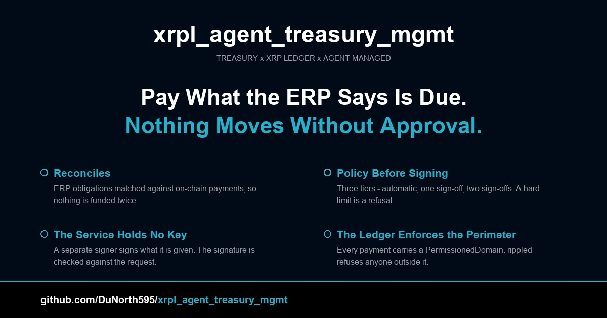

# xrpl_agent_treasury_mgmt

A treasury tool for the XRP Ledger. An ERP has obligations; the tool
decides which ones to pay, asks for the authorisations its policy requires,
obtains a signature from a signer it does not hold a key for, and submits the
payment — with every payment confined to a ledger-enforced tenant domain.

[](LICENSES/MIT.txt)
[](https://www.python.org/downloads/)
[](https://pypi.org/project/xrpl-py/)
[](https://reuse.software/)
[](https://hub.xerj.org/contributors/DuNorth595)

<p align="center">
  
</p>

<!-- The banner is generated. Edit scripts/build_social_preview.py and re-run
     it to change the wording; do not hand-edit the JPEG. -->

---

## What this is

It moves a tenant's own money between accounts it controls, under a policy,
with a human authorisation trail:

| Piece | What it is |
|---|---|
| Reconciler | ERP obligations matched against on-chain payments, so nothing is funded twice |
| Planner | Obligations turned into disbursements, in the currency each counterparty invoices in |
| Policy engine | Three tiers — automatic, one sign-off, two sign-offs — with per-tenant limits |
| External signer | A separate service that holds the key; this service never does |
| PermissionedDomain | The tenant perimeter, enforced by rippled rather than by the application |
| Decision log | Every decision, hash-chained, so an altered entry breaks the chain |

**Not** a custody solution, a bank, a wallet manager, or a payment processor.
The service moves money only inside a PermissionedDomain, and only for a
tenant it is configured to serve.

**Status:** v0.1.0, MIT. Every claim below was verified against a local XRPL
devnet at network 15791 on 2026-11-02 — see [docs/POC.md](docs/POC.md). Not
production-ready: no TLS, no token expiry, no rate limiting, and the bundled
signing service is a local stand-in for a custodian. The gaps are in
[TODO.md](TODO.md) and [SECURITY.md](SECURITY.md).

### The three properties that make it defensible

**The service holds no signing key.** A compromise of the service process does
not, by itself, move money. The key lives in the signing service, and the
signing service has no idea what a treasury obligation is — it signs what it
is given. The signature it returns is verified against the transaction that
was requested, so a signer that returned a signature over a different
destination would be rejected.

**The perimeter is the ledger's, not the application's.** A
`PermissionedDomain` on the payment is checked by rippled. A payment to a
non-participant is refused with `tecNO_PERMISSION` regardless of what the
application believes. Verified behaviourally: the harness simulates a payment
to a non-participant and requires the ledger's own refusal.

**It fails closed.** If the ERP or the ledger cannot be read, the plan is
withheld with a stated reason. It is never presented as an empty plan,
because an empty plan is indistinguishable from nothing being due.

---

## Quick start

Requires Python 3.10+ and Docker (for the local ledger).

```bash
git clone https://github.com/DuNorth595/xrpl_agent_treasury_mgmt.git
cd xrpl_agent_treasury_mgmt

python3 -m venv .venv && source .venv/bin/activate
pip install -e ".[dev]"

# Build the ledger, the currencies, the domain, the treasury's funding and
# the domain membership; start the services; run the suite. ~130 seconds
# from an empty ledger.
python3 dev_env.py fresh
```

| Service | Where | What it is |
|---|---|---|
| The ledger | `ws://127.0.0.1:6006` | `rippleci/xrpld:3.4.1`, network 15791 |
| The reference ERP | `http://127.0.0.1:8096` | stands in for the real ERP |
| The signing service | `http://127.0.0.1:8098` | holds the key — a stand-in for a custodian |
| The treasury service | `http://127.0.0.1:8095` | holds no key |

Open `http://127.0.0.1:8095/` for the dashboard.

```bash
python3 dev_env.py status                # what is running
python3 dev_env.py verify-all --allow-move   # every layer
python3 dev_env.py down                  # stop everything
```

---

## The policy tiers

| Tier | Trigger | Sign-offs |
|---|---|---|
| Level 1 | nothing warrants human judgement | 0 — automatic |
| Level 2 | inside the due-date buffer (short notice), or no linked obligation | 1 |
| Level 3 | a first payment to this counterparty, beyond the treasury manager's delegated authority, or a participant designated for supervisor review | 2 |
| Refused | outside the policy envelope entirely | — |

Hard limits are refusals, not escalations: a transfer over the single limit or
the daily cap is refused outright, because no amount of authorisation makes an
over-limit transfer compliant.

The counts are configurable per tenant. Limits are evaluated at the **USD
equivalent** of the obligation's currency, because a CA$1,000 limit is not a
US$1,000 limit — at the rate in use it is about US$715.61.

---

## The API

Every operational endpoint needs a bearer token with the right scope.

```bash
TOKEN=$(python3 mint_token.py --name ops --scopes treasury:read,treasury:settle)

curl -s -H "Authorization: Bearer $TOKEN" \
  http://127.0.0.1:8095/api/tenant/s-devlab-corp/position
```

| Scope | Allows |
|---|---|
| `treasury:read` | the position, the plan, the obligations, the log, the authorisations |
| `treasury:propose` | a dry run |
| `treasury:authorise` | recording a sign-off |
| `treasury:settle` | submitting a real payment |
| `treasury:admin` | everything |

A credential can also be restricted to particular tenants with `--tenants`,
and the restriction is enforced by the service.

**A route with no declared scope is refused, not allowed.** The scope map is
explicit, so forgetting to declare one produces a 403 on a new endpoint rather
than an unprotected one.

Sixteen sample endpoints under `/api/sample/` let you explore the behaviour
without a credential — twelve `GET` and four `POST`. None of them submit a
transaction except `/api/sample/settle`, which requires `"confirm": true`.

---

## Testing

Four independent layers. Each one can fail alone.

```
$ python3 dev_env.py verify-all --allow-move

  PASS  unit tests                   187 passed
  PASS  the API harness              PASS - 38/38 checks
  PASS  the verification harness     17/17 assertions passed
  PASS  the scale harness            PASS - 4/4 phases (1 skipped)

  4/4 layers pass
```

| Layer | What it covers | Result |
|---|---|---|
| Unit tests | the pure logic | **187 passed** |
| The API harness | the HTTP contract against a live service | **38/38 checks** |
| The verification harness | the service end to end, against a live ledger | **17/17 assertions** |
| The scale harness | throughput, correctness, stability, deployment readiness | **4/4 phases** |

In a clean checkout, without a local devnet, the unit suite reports
**177 passed, 10 skipped**. The ten are the external-signer tests: they sign
against a real devnet account, so without one they skip and say why. Every
other test runs anywhere.

The unit suite is ledger-free on purpose, so it runs on a GitHub runner. The
other three need a node; `dev_env.py` stands one up.

> In a clean checkout, without a local devnet, `pytest tests/ -q` reports
> **177 passed, 10 skipped**. The ten are the external-signer tests, which
> need a devnet account to sign against. Every other test runs anywhere.

### The scale numbers

The service processes **1,000,000 instructions at 3,801/sec, peak 97 MB**,
with the policy holding throughout: **zero** instructions missing a
`DomainID`, **zero** outside the policy envelope.

That is *service-side* throughput — planning, evaluation, authorisation,
building and signing. It is **not** a claim about settlement rate. One
transaction settles per closed ledger, and the local devnet closes a ledger
about every three seconds, so settlement caps near **0.3
transactions/second**. The two are reported separately because they are
different things.

The scale harness's settlement phase is **skipped by default** and is
reported as skipped rather than passed. Run it with `--settle 3` to submit
real transactions and confirm them in a closed ledger.

### The defects the harnesses found

The suite is not decoration. Every one of these was found by a test or a
review, not by reading the code — including a dry-run endpoint that returned
HTTP 200 with a `NameError` for every request, a `--scopes` flag that
silently escalated privilege, and an executor that never advanced the account
sequence so a second transaction was rejected with `tefPAST_SEQ`.

[docs/POC.md](docs/POC.md) has the full list.

---

## Documentation

| Doc | Purpose |
|---|---|
| [`docs/ARCHITECTURE.md`](docs/ARCHITECTURE.md) | The components, the boundaries, and why each boundary is where it is |
| [`docs/DESIGN.md`](docs/DESIGN.md) | The design decisions and the alternatives that were rejected |
| [`docs/DEPLOYMENT.md`](docs/DEPLOYMENT.md) | Running it for real: configuration, the WSGI server, the signing service, the checklist |
| [`docs/API.md`](docs/API.md) | Every endpoint, what it returns, and what it needs |
| [`docs/POC.md`](docs/POC.md) | The proof: what is demonstrated, how to reproduce it, and what each result does **not** establish |
| [`SECURITY.md`](SECURITY.md) | The trust model, the authentication scheme, and the known limitations |
| [`TODO.md`](TODO.md) | What is left, in priority order, with what "done" means for each item |

---

## Related projects

- [`xrpl_agent_log`](https://github.com/DuNorth595/xrpl_agent_log) — the hash-chained decision log this service writes, as a standalone library
- [`xrpl_agent_id`](https://github.com/DuNorth595/xrpl_agent_id) — agent identity and authorisation on XRPL
- [`xrpl_did_mcp`](https://github.com/DuNorth595/xrpl_did_mcp) — MCP server exposing agent identity to any AI agent client
- [`xrpl-py`](https://github.com/XRPLF/xrpl-py) — the Python client this builds on

---

## License

MIT — see [LICENSES/MIT.txt](LICENSES/MIT.txt).

```
SPDX-FileCopyrightText: 2026 Justin Douglas
SPDX-License-Identifier: MIT
```

**Author:** Justin Douglas — design, implementation, and stewardship.

**Built with Sam Intelligence** — an AI coding assistant (Hermes Agent, Nous
Research) that contributed to implementation, documentation, and architecture
under direct human supervision. All design decisions, specification
interpretations, and final commits were reviewed and approved by Justin
Douglas.

**Built on the shoulders of:** [Wietse Wind](https://github.com/WietseWind) and
`xrpl-py`; the [XRPL Foundation](https://xrpl.org/) for the ledger primitives;
and [Ripple Custody](https://ripple.com/) for the custody architecture this
design follows.

**How to cite:**

```bibtex
@software{xrpl_agent_treasury_mgmt_2026,
  author = {Douglas, Justin},
  title = {xrpl_agent_treasury_mgmt: Treasury tool for the XRP Ledger},
  year = {2026},
  url = {https://github.com/DuNorth595/xrpl_agent_treasury_mgmt}
}
```

---

## Releases

| Version | Date | Highlights |
|---|---|---|
| [v0.1.0](https://github.com/DuNorth595/xrpl_agent_treasury_mgmt/releases/tag/v0.1.0) | 2026-11-03 | **First public release.** A treasury tool for the XRP Ledger: ERP reconciliation, three-tier authorisation policy, an external signer the service does not hold a key for, and a ledger-enforced `PermissionedDomain` perimeter. |

Full history: [`CHANGELOG.md`](CHANGELOG.md).
